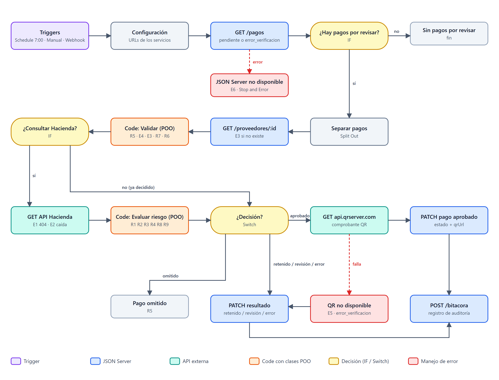
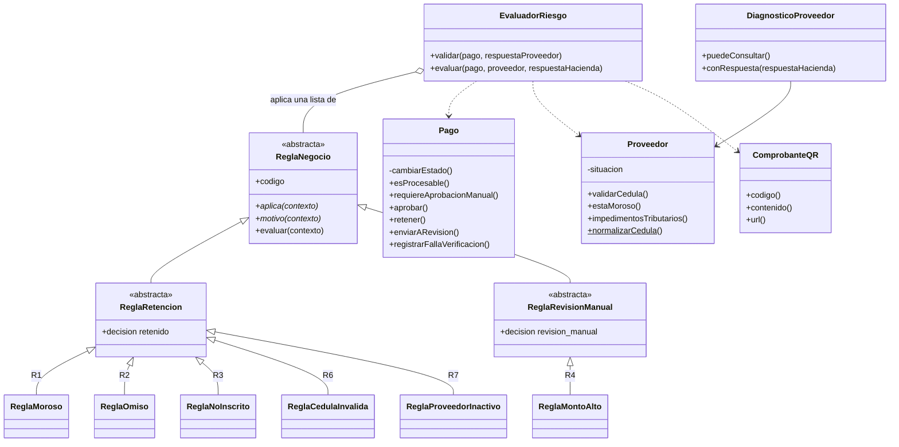
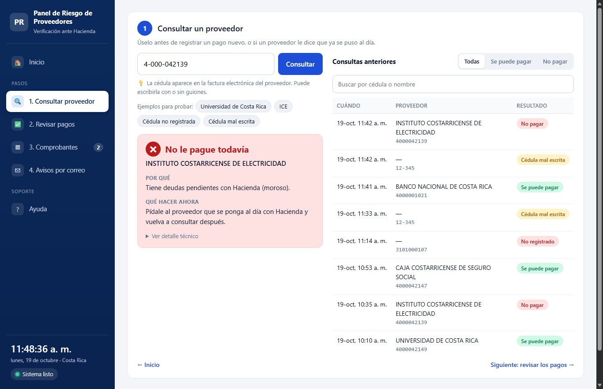
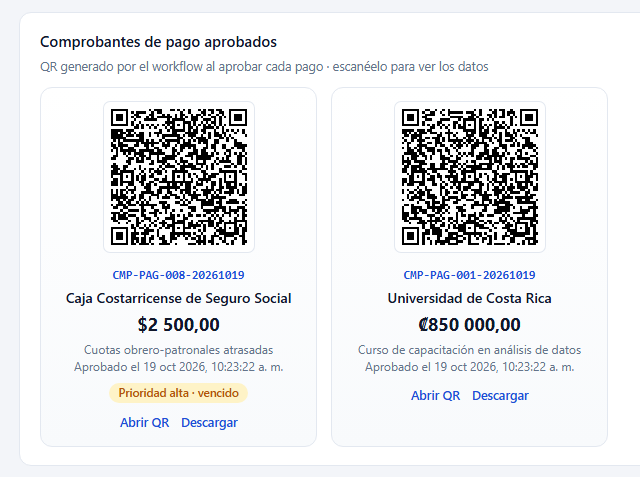

# Panel de riesgo de proveedores con comprobante QR

[](https://github.com/victorgonzalez246/Panel-de-riesgo-de-proveedores-con-comprobante-QR/actions/workflows/pruebas.yml)

Laboratorio #1 — Soluciones de Negocio: POO + n8n (escenario 4).

Antes de aprobar un pago, la empresa verifica que el proveedor no esté moroso ante Hacienda. Un workflow de n8n toma los pagos pendientes de **JSON Server**, consulta la **API de Hacienda** por cada proveedor y, si está al día, genera un **comprobante QR** (api.qrserver.com) y aprueba el pago. Si está moroso, omiso o algo falla, el pago queda retenido o en revisión manual con un motivo claro.

La lógica de negocio está modelada con clases en JavaScript puro (`src/`), y es **exactamente el mismo código** que ejecutan los nodos Code del workflow.



## Programación orientada a objetos

Cada regla de negocio es una clase. Todas heredan de `ReglaNegocio`, y `EvaluadorRiesgo` las aplica sin saber cuál es cuál:



| Pilar | Dónde se aplica |
|---|---|
| **Abstracción** | `ReglaNegocio`, `ReglaRetencion` y `ReglaRevisionManual` no se pueden instanciar; definen `aplica()` y `motivo()` que cada regla concreta debe implementar. |
| **Herencia** | Las 6 reglas heredan de `ReglaRetencion` o `ReglaRevisionManual`, y de ellas reciben su `decision` y el método `evaluar()`. |
| **Polimorfismo** | `EvaluadorRiesgo` llama `regla.evaluar(contexto)` sobre una lista de reglas; cada subclase responde a su manera. Una regla nueva se agrega sin modificar el evaluador (ver `tests/poo.test.js`). |
| **Encapsulamiento** | `Pago` solo cambia de estado mediante sus métodos (`#cambiarEstado` es privado), y `Proveedor` guarda la situación tributaria que interpreta él mismo. |

## Estructura

```
├── src/
│   ├── config.js            umbrales y estados (parámetros de negocio)
│   ├── ReglaNegocio.js      jerarquía de reglas R1, R2, R3, R4, R6 y R7
│   ├── Proveedor.js         cédula, actividad y situación tributaria
│   ├── Pago.js              validación, umbral, vencimiento y cambios de estado
│   ├── ComprobanteQR.js     código y URL del comprobante QR
│   ├── EvaluadorRiesgo.js   validar() y evaluar(): las dos decisiones del workflow
│   ├── DiagnosticoProveedor.js  consulta puntual de una cédula (panel web)
│   └── ResumenRevision.js   correo de resumen para tesorería (extensión, reto 3)
├── main.js                  prueba las clases por consola sin n8n
├── tests/                   30 pruebas automatizadas (reglas, errores, diagnóstico, POO y correo)
├── public/index.html        panel web (extra opcional), lo sirve JSON Server
├── db.json                  base de datos de JSON Server (local, no se sube a Git)
├── data/
│   ├── db.inicial.json      datos de prueba originales (para reiniciar)
│   └── respuestas-hacienda.json  respuestas reales de Hacienda guardadas
├── n8n/
│   ├── workflow-panel-riesgo.json    workflow principal (revisión diaria de pagos)
│   └── workflow-consulta-cedula.json Webhook que usa el panel web
├── scripts/
│   ├── build-workflow.js    genera el workflow copiando las clases a los nodos Code
│   └── reset-db.js          restaura db.json
└── docs/
    ├── documento-logica-negocio.docx / .pdf
    ├── diagrama-workflow.png
    ├── img/                 capturas del panel
    └── guion-presentacion.md
```

## Cómo ejecutarlo

Requisitos: Node.js 22+ y n8n (probado con n8n 2.38.6 local).

```bash
npm install
npm test              # 30 pruebas
node main.js          # métodos de las clases + evaluación de los 10 pagos
node main.js --en-vivo   # igual, pero consultando Hacienda en este momento
npm run api:limpio    # reinicia db.json y levanta JSON Server en http://127.0.0.1:3000
```

En n8n: **Workflows → Import from File →** `n8n/workflow-panel-riesgo.json`, y luego **Execute workflow**.

> JSON Server se levanta sin `--watch` y en `127.0.0.1` a propósito. Con `--watch` se recarga a sí mismo tras cada escritura y deja de responder por un instante; con `localhost`, n8n intenta conectar por IPv6 (`::1`), que JSON Server no escucha.

Si se cambia una clase de `src/`, regenerar los workflows con `npm run build:workflow` y volver a importarlos.

## Panel web (extra opcional)

> El laboratorio pide una solución "sin interfaz visual". El panel es un **agregado**: no reemplaza ni modifica el workflow principal, y usa las mismas clases.

Panel ejecutivo en **http://127.0.0.1:3000** (lo sirve JSON Server desde `public/`):





- Indicadores de los pagos: aprobados, retenidos, en revisión manual y por verificar.
- **Consultar proveedor**: se ingresa una cédula (acepta guiones) y se verifica en tiempo real.
- **Consultas anteriores**: el historial guardado en `/consultas`, con fecha y hora de Costa Rica y un filtro.
- **Comprobantes de pago aprobados**: tarjetas con la imagen del QR de cada pago aprobado, para abrirlo o descargarlo.
- **Ejecutar revisión de pagos**: botón que dispara el workflow principal (`POST /webhook/revision-pagos`) y va mostrando el avance hasta que termina.
- Tabla de pagos con su estado, motivo y enlace al comprobante QR.

La consulta pasa por n8n. El panel hace `POST http://localhost:5678/webhook/consulta-cedula`; el workflow **Consulta de cédula (panel)** valida la cédula con `DiagnosticoProveedor` (R6), consulta Hacienda, interpreta la respuesta (R1, R2, R3, E1, E2), guarda la consulta en JSON Server y le responde al panel.

Para que los webhooks respondan, los dos workflows deben estar **publicados** (con n8n detenido; luego `n8n start`):

```bash
n8n import:workflow --input=n8n/workflow-panel-riesgo.json
n8n import:workflow --input=n8n/workflow-consulta-cedula.json
n8n publish:workflow --id=PanelRiesgoQR001
n8n publish:workflow --id=ConsultaCedula01
```

(o abrir cada uno en n8n y pulsar **Publish**). Al publicar el workflow principal también queda activa la revisión automática diaria de las 7:00, mientras n8n esté abierto.

`db.json` no se sube a Git porque guarda las consultas reales hechas desde el panel. `npm run api` lo crea desde `data/db.inicial.json` si no existe, y `npm run api:limpio` lo reinicia. Enlace directo para la demo: `http://127.0.0.1:3000/?cedula=4000042139`.

## Extensión del laboratorio

| Reto | Estado | Dónde |
|---|---|---|
| 1. Jerarquía de clases con herencia y polimorfismo | ✅ | `src/ReglaNegocio.js` (ver *Programación orientada a objetos*), usada también en los nodos Code |
| 3. Notificación automática por correo | ✅ | `src/ResumenRevision.js` y los nodos **Preparar notificación (POO)** → **¿Hay situaciones críticas?** → **Enviar correo a tesorería** |

Al final de cada revisión se envía **un solo correo** de resumen, y solo si hay pagos retenidos, en revisión manual o con error. Incluye los proveedores morosos destacados en el asunto, el motivo de cada pago y los QR de los aprobados. Como las ramas del workflow llegan a la bitácora por separado, **Preparar notificación (POO)** cuenta las corridas con `$runIndex` y solo arma el correo cuando ya están registrados todos los pagos.

**Activar el correo (Gmail):**

1. En la cuenta de Google, activar la verificación en 2 pasos y crear una **contraseña de aplicación** en https://myaccount.google.com/apppasswords.
2. En n8n, crear (o editar) la credencial **SMTP** llamada `Gmail SMTP (Panel de riesgo)`: usuario = la cuenta de Gmail, contraseña = la contraseña de aplicación, host `smtp.gmail.com`, puerto `465`, SSL/TLS activado.
3. En el nodo **Configuración** del workflow, poner `correoRemitente` (la misma cuenta de Gmail) y `correoTesoreria` (quien recibe el resumen). En el repositorio quedan direcciones de ejemplo a propósito.

Si el envío falla, el workflow no se detiene: los pagos ya quedaron registrados y el error se ve en la ejecución del nodo de correo.
## Datos de prueba

| Pago | Proveedor | Resultado esperado |
|---|---|---|
| PAG-001 | Universidad de Costa Rica (al día) | **aprobado** + QR |
| PAG-002 | ICE (moroso real en Hacienda) | **retenido** — R1 |
| PAG-003 | Banco Nacional, ₡7 500 000 | **revisión manual** — R4 |
| PAG-004 | Cédula 3101000107 (404 en Hacienda) | **retenido** — E1 |
| PAG-005 | Cédula "12-345" | **retenido** — R6 |
| PAG-006 | Proveedor PRV-099 inexistente | **revisión manual** — E3 |
| PAG-007 | Pago sin monto | **revisión manual** — E4 |
| PAG-008 | CCSS ("Inscrito de oficio"), vencido | **aprobado** + QR, prioridad alta — R8 |
| PAG-009 | RECOPE, inactivo en la empresa | **retenido** — R7 |
| PAG-010 | Ya aprobado antes | no se toca — R5 |

## Reglas de negocio

| | Regla | Resultado |
|---|---|---|
| R1 | Proveedor moroso | retenido |
| R2 | Proveedor omiso | retenido |
| R3 | Inscripción distinta de "Inscrito" / "Inscrito de oficio" | retenido |
| R4 | Monto > ₡5 000 000 o > $10 000 | revisión manual |
| R5 | Solo se revisan pagos `pendiente` o `error_verificacion` | — |
| R6 | Cédula con formato inválido (no se consulta Hacienda) | retenido |
| R7 | Proveedor inactivo en la empresa | retenido |
| R8 | Pago vencido | prioridad alta |
| R9 | Tercer intento de verificación fallido | revisión manual |

## Situaciones inesperadas

| | Situación | Manejo |
|---|---|---|
| E1 | Hacienda responde 404 | retenido |
| E2 | Hacienda caída, 5xx/429 o sin situación tributaria | `error_verificacion`, se reintenta (máx. 3, R9) |
| E3 | Proveedor no existe en JSON Server | revisión manual |
| E4 | Pago con datos incompletos | revisión manual |
| E5 | api.qrserver.com no genera el QR | 3 reintentos y luego `error_verificacion` |
| E6 | JSON Server apagado | el workflow se detiene con un mensaje claro |

**Demo de error en vivo:** en el nodo **Configuración**, cambiar `haciendaUrl` por `https://hacienda-caida.invalid/fe/ae` y ejecutar. Los pagos quedan en `error_verificacion` con el motivo `[E2]`. Al restaurar la URL y ejecutar de nuevo, se procesan normalmente.

## Entregables

- Workflow funcionando: `n8n/workflow-panel-riesgo.json`
- Clases POO: `src/` + `main.js`
- Documento de lógica de negocio: `docs/documento-logica-negocio.pdf` (y `.docx`)
- Guía de la presentación: `docs/guion-presentacion.md`
